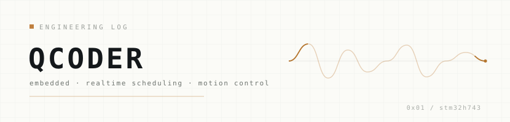

<p align="center">
  <picture>
    <source media="(prefers-color-scheme: dark)" srcset="./assets/banner-dark.svg">
    
  </picture>
</p>

我做嵌入式底层。手上这套东西叫 **MC_Bus** —— 一套自己写的确定性实时调度框架，
跑在 STM32H743 上；现在正拿它驱动一台麦轮底盘和一条并联 SCARA。

不追漂亮的架构图，只追一件事：**上电之后，行为是可预测的**。

[现在](#now) · [项目](#work) · [工具链](#stack) · [联系](#links)

---

## now

| 在做 | 节奏 | 怎么看 |
| :-- | :-- | :-- |
| 把 MC_Bus 的调度层与底盘观测侧收干净：调度表静态化、观测器与控制解耦。先让测量可信，再动机制。 | 一次只改一项。先回退到已知可用基线，单变量隔离，让日志说话，不让感觉说话。 | 看项目里「结果」那一行。写不出数字的，就先不写。 |

```console
$ mc_bus --status
sched ···· ready ······· 表驱动 / 编译期定相位
data ····· ready ······· 无状态纯算法，内存由调用方持有
chassis ·· iterating ··· 观测侧先行
```

## work

<details>
<summary><b>01 · MC_Bus</b> — 确定性实时调度框架 &nbsp; <code>stm32h743</code> <code>c11</code> <code>运行中</code></summary>
<br>

- **问题** — 动态优先级加抢占，最坏响应时间说不清；而控制环真正要的，恰恰是一个能证明的上界。
- **约束** — Cortex-M7 单核；RAM 紧张；不接受动态内存与运行时管理开销；厂家库够用就复用，不重写。
- **方案** — 调度表编译期用 X-Macro 展开，顺序与相位静态确定；引擎只持指针和计数，数组归组合根（调用方）所有；data_bus 退化成无状态纯算法，每个 topic 注入内存。
- **结果** — 接新任务只加一条表项；slot 级 enabled 支持动态启停且不破相位；引擎不再越层管内存。

</details>

<details>
<summary><b>02 · 麦轮底盘</b> — 速度环与里程计 &nbsp; <code>四轮直驱</code> <code>6 电机轮询</code> <code>迭代中</code></summary>
<br>

- **问题** — 开环里程计有横漂，而且不均匀：每次起步后约 80ms 出现一次角速度尖峰，最差量级 6.7mm。
- **约束** — 陀螺仪 50Hz、比例因子有约 3% 校准误差，只能当角速度源，不能当角度真值；优化期内冻结位置模式；6 台电机同优先级，底盘不得独占轮询。
- **方案** — 三轴速度环闭环，vx/vy 取电机正解算速度，yaw 角速度只信陀螺仪；起步 ramp 释放时做外推修正；正向运动学矩阵满足 KᵀK = 4I，伪逆可平凡求解。
- **结果** — 横漂根因锁定在 ramp 释放瞬间，而不是通信丢帧；三个量化误差源（指令量化、单轮速度环欠给、驱动栅相位）已分别定位。

</details>

<details>
<summary><b>03 · 并联 SCARA</b> — 关节空间控制 &nbsp; <code>双电机共底座</code> <code>1:10</code> <code>设计阶段</code></summary>
<br>

- **问题** — 双电机共底座、镜像安装，上电没有绝对零位；两个关节还共用同一条总线。
- **约束** — 无机械限位可参考；不插补；运动学解算排在关节空间之后；五杆连杆尚未安装。
- **方案** — 上电默认零点加手动标定方向；指令在同一帧内按多地址同步下发，保证确定性，拒绝广播触发；关节角由单圈线性化编码器位与多圈位置位组合解算。
- **结果** — 首版关节空间控制就位，方向标定由代码侧承担；运动学解算是下一步。

</details>

## stack

| 方向 | 现在用的 |
| :-- | :-- |
| **语言** | C（C11）主线 · Python 做分析与脚本 |
| **内核** | STM32H743（HAL 与寄存器级）· Cortex-M7 · 瑞萨 RA 做过跨内核可移植验证 |
| **系统** | Linux 日常 · Jetson Orin Nano 边缘推理与串口链路 |
| **总线** | USART 三路收敛 · 类 Modbus 电机总线 · 自定义二进制帧（head + COBS + CRC16 + TLV） |
| **方法** | 表驱动 · 无状态纯算法 · 显式静态分配 · 单变量验证 · 用日志做对照实验 |

## links

**邮箱** · [2770952796@qq.com](mailto:2770952796@qq.com) —— 技术讨论、实习、合作都走这里。
**主页** · 就是本仓库。头图在 [`assets/`](./assets)，亮暗两套，随系统主题自动切换；同目录的 `index.html` 是一个可离线打开的同款网页版。

---

<sub>每条记录都带日期，写不出数字的先不写。更新于 2026.10.30 · 本页图像全部在 <code>assets/</code> 内，不依赖任何第三方统计组件。</sub>
