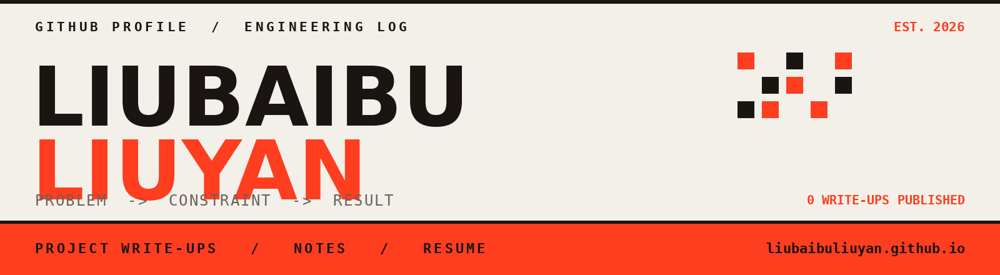

<a href="https://liubaibuliuyan.github.io">
  
</a>

<br>

**这里是我的可验证工程记录**——每个项目都写清问题、约束、方案和结果。
复盘先写，代码整理好再放出，所以「已开源」的数量会落后于「做过」的数量。

> 📐 完整版主页 → <https://liubaibuliuyan.github.io>
> 项目复盘 · 技术笔记 · 简历（简历页可直接浏览器打印成 PDF）

```text
STATUS
  site         liubaibuliuyan.github.io
  write-ups    0 published
  repos        2 (profile + site)
  currently    整理已有项目 -> 写复盘 -> 放出代码
  contact      via GitHub issue / DM
```

---

## `01` 当前在做

| | |
| :-- | :-- |
| **主线** | 把手上的项目逐个写成公开复盘，每篇必须给出可量化结果 |
| **规则** | 没有数字的结果不写成文章；讲不清约束的方案不算做完 |
| **节奏** | 复盘先行。代码仓库等整理干净再推，不为了绿格子制造空提交 |

## `02` 项目复盘

完整列表在主页的 [项目页](https://liubaibuliuyan.github.io/projects)。这里只放**已开源**的仓库。

| # | 项目 | 问题 | 结果 |
| :-- | :-- | :-- | :-- |
| — | 暂无公开条目 | 复盘会先出现在主页，代码链接随后补上 | — |

<!-- 公开仓库后按这个格式加行，一行一个，结果必须带数字：
| 01 | [名字](链接) | 一句话说清什么坏了 | 4.2k QPS / 脏读 0 次 |
-->

## `03` 技术栈

<details>
<summary><b>展开查看</b>（只列真的用来交付过的，不放只会 tutorial 的）</summary>

| 方向 | 明细 |
| :-- | :-- |
| **语言** | 待填 |
| **系统** | 待填 |
| **工具** | 待填 |

</details>

## `04` 关于这个页面

主页是 Astro 静态站，内容全部是 Markdown 文件，push 到 `main` 由 GitHub Actions 自动构建部署。
源码公开，欢迎当模板用：[liubaibuliuyan.github.io](https://github.com/liubaibuliuyan/liubaibuliuyan.github.io)

```text
STACK     Astro 7  ·  GitHub Pages  ·  Actions
CONTENT   projects / writing 两个 Markdown 集合
GUARD     result 字段缺失 -> 构建直接失败
JS        首页除主题切换外零运行时
```

---

> 📮 联系方式暂未公开 —— 有招聘或合作意向，直接通过 GitHub 找我最快。
